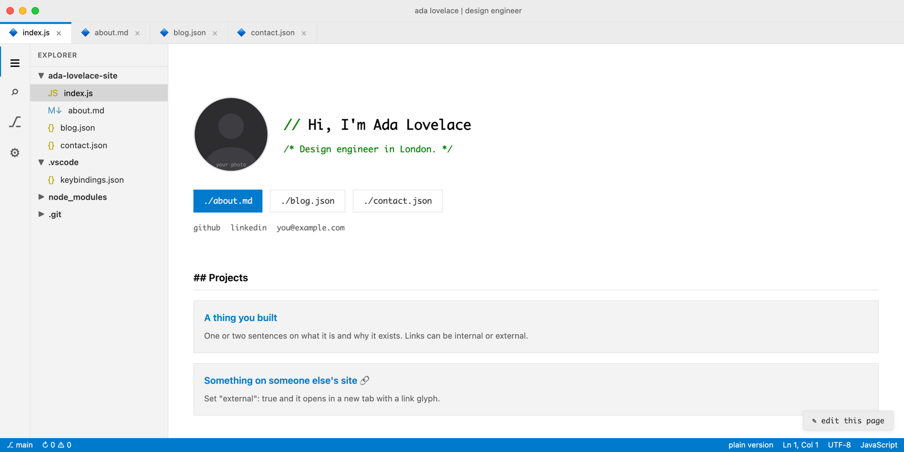
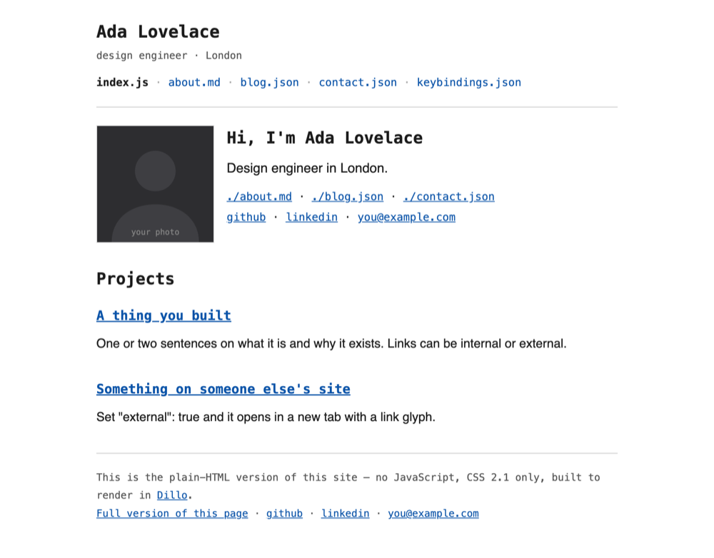
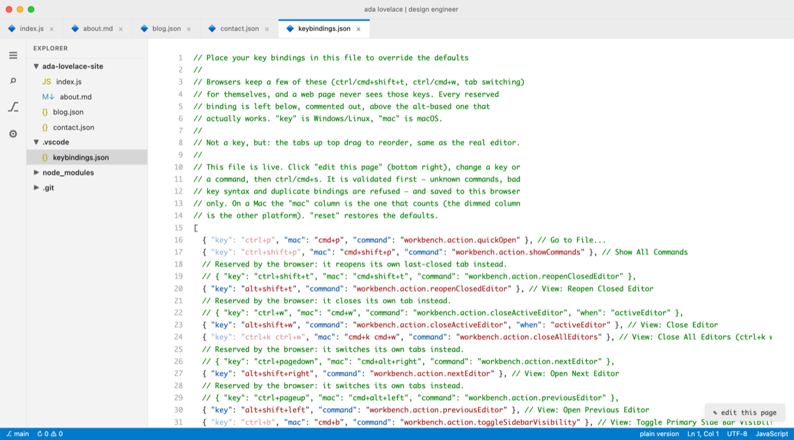

# vs-portfolio

A portfolio site that looks like a code editor. Express + EJS, content in JSON
files, and a second set of templates that render the same pages as plain HTML
for browsers that run no JavaScript.

Live example: **[joewaine.com](https://joewaine.com)** — this is that site with
the personal bits taken out.



The chrome is not a static picture. Tabs close and reorder by dragging, the
explorer folders collapse, `⌘P` opens a working Go-to-File palette, `⌘⇧P` opens
a command palette, and there's a button that lets a visitor edit the text of the
page in place — their edits stay in their own browser and are never sent
anywhere.

---

## Quick start

```bash
git clone https://github.com/joewaine/vs-portfolio my-site
cd my-site
npm install
npm start          # http://localhost:3000
```

`npm run dev` restarts on file changes. Node 20 or newer.

## Making it yours

**Start with `content/site.json`.** It drives the whole window: the title bar,
the tab strip, the explorer tree, the status bar, the hero block and the links
under it. Change the names, add and remove files, and both the editor version
and the plain-HTML version follow.

```json
{
  "name": "Ada Lovelace",
  "titlebar": "ada lovelace | design engineer",
  "greeting": "Hi, I'm Ada Lovelace",
  "tagline": "Design engineer in London.",
  "photo": "/img/avatar.svg",
  "email": "you@example.com",
  "social": [{ "label": "github", "url": "https://github.com/you", "external": true }],
  "explorer": [
    {
      "folder": "ada-lovelace-site",
      "open": true,
      "files": [
        { "label": "index.js", "icon": "js", "url": "/", "page": "home" }
      ]
    },
    { "folder": "node_modules", "open": false }
  ]
}
```

A file entry takes:

| key | what it does |
| --- | --- |
| `label` | the filename shown in the tab and the explorer |
| `url` | where it links |
| `page` | matches the `page` a route renders with, which is how the active tab is highlighted |
| `icon` | `js`, `md`, `json`, `py`, `sh` — or set `glyph` to any character |
| `defaultClosed` | the tab stays hidden until a visitor opens the file from the explorer |
| `external` | opens in a new tab; left out of the plain-HTML nav |

A folder with no `files` is decoration — that's what `node_modules` and `.git`
are for.

**Then the rest of `content/`:**

- `about.json` — bio, skills, background. One paragraph per line.
- `blog.json` — an array of posts. `id` is the URL slug, `content` is HTML.
- `contact.json` — email and social links.
- `projects.json` — the list on the home page.

Replace `public/img/avatar.svg` with your own photo and point `site.photo` at
it. To offer a resume, drop the PDF in `public/downloads/` and add it to
`social` as `{ "label": "resume", "url": "/downloads/resume.pdf" }`.

## The plain-HTML version

Every page exists twice. `views/*.ejs` is the editor pastiche — flexbox, custom
properties, a bit of JavaScript. `views/lite/*.ejs` is the same content in CSS
2.1 with no script tags at all, so it renders in
[Dillo](https://dillo-browser.org/), NetSurf, Lynx and w3m.

`dillo.js` switches between them. It turns on for a known no-JavaScript
User-Agent, for `?lite=1`, or for anyone who has clicked **plain version** in
the status bar before. `?lite=0` opts back out.



> **Adding a page? Add its `views/lite/` twin.** Without one it falls back to the
> JavaScript-dependent template and renders as an unstyled pile.
> `test/dillo.test.js` fails the build if you forget.

## Adding a page

1. A route in `server.js` that renders with a `page` name:
   ```js
   app.get('/uses', (req, res) => {
     res.render('uses', { page: 'uses', title: 'Uses', gear: readJSON('uses.json') });
   });
   ```
2. `views/uses.ejs` — start by copying `views/about.ejs`.
3. `views/lite/uses.ejs` — start by copying `views/lite/about.ejs`.
4. An entry in `site.json`'s `explorer` with `"page": "uses"`.

## The admin panel

`/admin` edits `about.json`, `contact.json` and `blog.json` through a form.
**It is off until you set a password:**

```bash
ADMIN_PASSWORD=something-long npm start
```

Without it, every `/admin` URL answers 503. Sessions live in memory in one
process, which is right for one person editing their own site and wrong for
anything bigger — put a real session store there before you grow.

It writes to the JSON files on disk, so on a host with an ephemeral filesystem
(Render, Fly, Heroku) posts vanish on the next deploy. Editing the files in git
and pushing is the durable path; treat the panel as a convenience for local use.

## Deploying

It's an ordinary Node server — anything that runs `npm start` and gives you a
`PORT` works. Static hosts (GitHub Pages, plain Netlify) do not, because the
pages are rendered per request.

A [Render](https://render.com) blueprint is included; `render.yaml` builds with
`npm ci` and starts with `npm start`. Set `ADMIN_PASSWORD` in the dashboard if
you want the panel, and `NODE_ENV=production` either way.

## Keyboard shortcuts

`/keybindings` renders them as a VS Code `keybindings.json`, syntax-highlighted,
and you can edit and save it in the browser — the bindings persist in your own
localStorage. A few of the real VS Code chords are reserved by browsers; those
are listed commented-out next to the `alt`-based binding that does work.



`keybindings.js` is the page, `public/js/edit.js` is what binds the keys, and
`test/keybindings.test.js` fails if the two ever disagree.

## Tests

```bash
npm test      # node --test, no framework
```

Covers the routes, the explorer/chrome coming from `site.json`, the lite-twin
rule, the admin lock, and the keybinding sync.

## Layout

```
server.js          routes, the JSON read/write helpers, the admin panel
dillo.js           plain-HTML mode: UA/cookie detection and the render override
keybindings.js     the /keybindings page, as VS Code keybinding entries
content/*.json     everything you edit
views/*.ejs        the editor templates
views/lite/*.ejs   the plain-HTML twins
public/css/        style.css (editor) and dillo.css (plain, CSS 2.1 only)
public/js/edit.js  tabs, palettes, folders, the edit-this-page toy
```

## License

MIT — see [LICENSE](LICENSE). Use it, change it, ship it. No attribution
required, though a link back is always nice.
